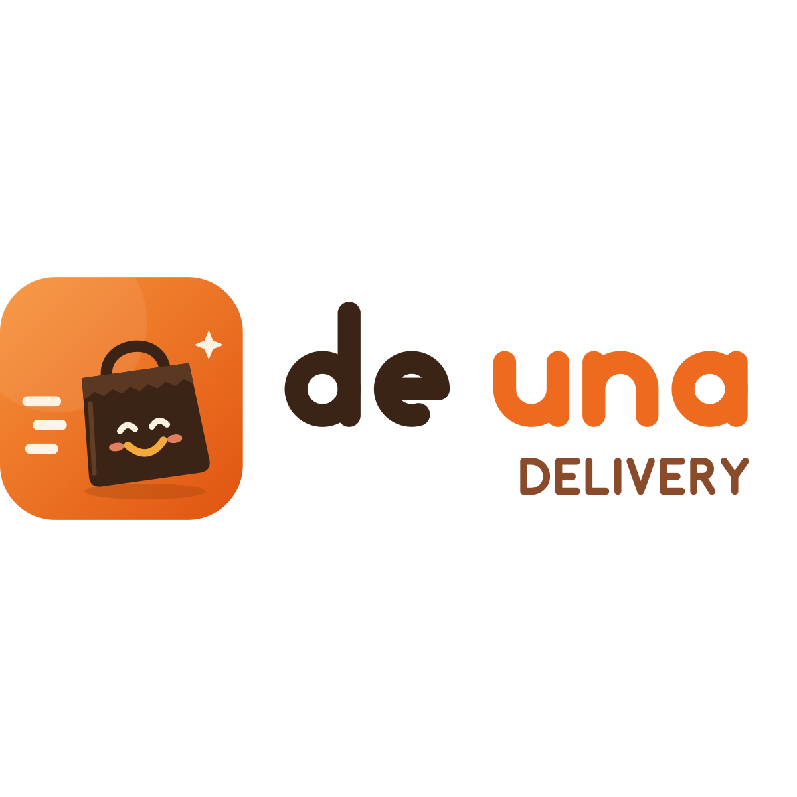

# De Una Delivery



**¿Se te antojó? ¡De una!** Una app de pedidos hecha para una sola zona: Toscana Alta, Casas Quma, Paseos de la Pradera, Atotonilco de Tula y Huehuetoca. Junta comida, tiendita, farmacia, **gas, garrafones** y mandados, con repartidores de la misma zona.

**Abrir la app:** https://abycmexico.github.io/de-una/

> **Estado: piloto.** Es una maqueta que funciona de verdad: todas las reglas (precios, estados del pedido, dinero, tiempos y antifraude) corren en un motor con pruebas automáticas. Todavía no tiene base de datos, así que cada celular ve su propia copia con datos de ejemplo.

## Instalarla en el celular (sin App Store)

- **iPhone:** ábrela en Safari, toca Compartir → **Agregar a inicio**.
- **Android:** ábrela en Chrome, toca ⋮ → **Instalar app**.

## Cómo probarla

Arriba eliges desde qué rol ves la app: **Cliente, Negocio, Repartidor o Admin**. Con el **reloj de la demo** adelantas 1, 5 o 10 minutos para ver los tiempos límite en acción.

**Un pedido de punta a punta:**

1. **Cliente:** pide en Tacos El Atlante y paga en efectivo.
2. **Negocio:** elige el tiempo, acepta y marca listo.
3. **Repartidor:** acepta la oferta y avisa que llegó a la tienda.
4. **Negocio:** le entrega el pedido y le cobra en tienda.
5. **Repartidor:** entrega con el código de 4 dígitos del cliente.
6. **Admin:** abre el pedido y mira “Cómo se movió el dinero”.

**Casos difíciles que ya resuelve:**

- El negocio no contesta en 5 minutos: el pedido se cancela solo y, con dos seguidos, el negocio se pausa.
- La transferencia no llega en 15 minutos: se cancela. No se aceptan capturas.
- El cliente no sale: 10 min de espera y 2 llamadas; al repartidor se le repone todo y el cliente queda con un adeudo.
- Código de entrega equivocado 3 veces: alerta al dueño.
- Ley seca, alcohol con INE, antibióticos solo en mostrador, gas con precio tope.
- Repartidor con mucho efectivo: deja de recibir pedidos en efectivo y, con más, se suspende.
- Varias cuentas en un celular, abuso de promos, reclamos repetidos.
- Operador que quiere devolver más de $100: lo tiene que aprobar el dueño.

## Documentación

| Documento | De qué trata |
|---|---|
| [0. Benchmark de la zona](docs/00-benchmark-de-la-zona.md) | La zona, la competencia y por qué la app es como es |
| [1. Modelo de negocio](docs/01-modelo-de-negocio.md) | Cómo gana dinero, un pedido peso por peso, Plus, el escenario del piloto y los guiones para convencer |
| [2. Un pedido de punta a punta](docs/02-pedido-de-punta-a-punta.md) | Estados, quién hace qué, tiempos límite, código de entrega, cancelaciones, reclamos |
| [3. El dinero](docs/03-dinero.md) | Modelo mixto, fórmulas, libro de movimientos, cortes y límites de efectivo |
| [4. Repartidores](docs/04-repartidores.md) | Alta, asignación de viajes, ofertas, ganancias y protecciones |
| [5. Negocios](docs/05-negocios.md) | Alta por giro, recibir y entregar pedidos, mensualidad, anuncios |
| [6. Antifraude](docs/06-antifraude.md) | Cada fraude posible, cómo se frena y dónde está en el código |
| [7. Panel del dueño](docs/07-panel-del-dueno.md) | Pantallas, alertas, dueño y operador, bitácora |
| [8. Arquitectura](docs/08-arquitectura.md) | Cómo está hecho, tablas para Supabase, seguridad y hoja de ruta |
| [9. Reglas y cumplimiento](docs/09-reglas-y-cumplimiento.md) | PROFECO, alcohol, medicamentos, gas, datos personales |
| [10. La marca](docs/10-marca.md) | Logo, ícono, colores, tipografía, ilustraciones y tono de voz |

## Cómo está hecho

```
index.html          La página (PWA instalable)
marca/              Logo, ícono y el script que los genera (marca/generar.js)
js/marca.js         Piezas de la marca para la app (generado)
ilustraciones.js    Ilustraciones propias, con estilo de estampa
js/motor.js         Todas las reglas del negocio, sin pantallas
js/datos.js         Datos de ejemplo, generados con el mismo motor
js/app.js           Las pantallas: dibujan y le preguntan al motor
pruebas/            Pruebas automáticas del motor
docs/               Documentación
```

No usa librerías ni pasos de compilación: es HTML, CSS y JavaScript.

## Pruebas

Necesitas [Node.js](https://nodejs.org) 20 o más reciente.

```bash
node --test
```

Son 23 pruebas: precios, estados, tiempos límite, asignación de repartidores, efectivo, promos, reclamos, cancelaciones y mensualidades, y que **el dinero cuadre en cada pedido** para el cliente, el negocio, el repartidor y De Una.

## El modelo en una tabla

| Quién | Paga | Recibe |
|---|---|---|
| Cliente | Productos al precio del local + envío por zona ($25 / $35 / $45) + $7 de servicio + propina opcional | Su pedido, con código de entrega |
| Negocio | $399 al mes, 0 % de comisión | El 100 % de sus ventas: en tienda (efectivo) o depositado cada noche (en línea) |
| Repartidor | Nada | 85 % del envío + 100 % de propina, lluvia y pedido pequeño |
| De Una | Promos y garantías | Mensualidades, servicio, 15 % del envío, Plus ($49 al mes) y anuncios |

---

Hecho por [Abyc](https://abycagency.com) en México.
