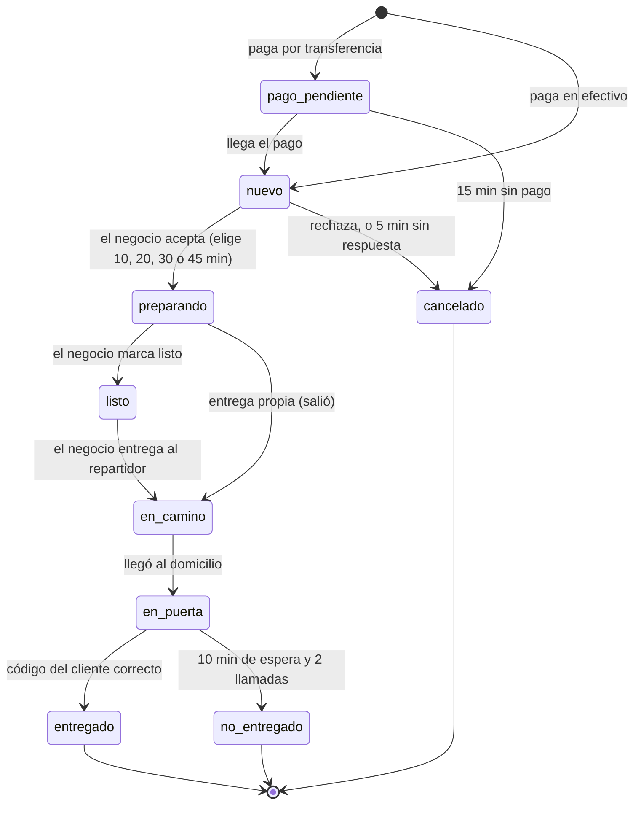
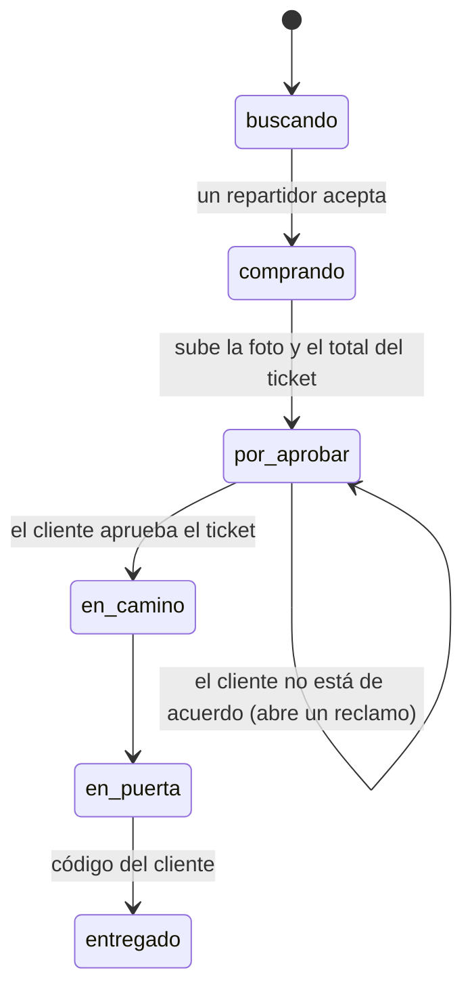

# 2. Un pedido de punta a punta

Cada pedido sigue una **máquina de estados**: solo puede pasar de un estado a otro con una acción permitida, hecha por la persona correcta y en el momento correcto. La regla vive en `validar()` de [`js/motor.js`](../js/motor.js); las pantallas solo preguntan y muestran la respuesta.

Hay tres tipos de pedido:

1. **Tienda con repartidor de manda2**: restaurantes, tiendita y farmacia.
2. **Tienda con entrega propia**: gaseras y purificadoras, que llevan el pedido con su propio personal.
3. **Mandado**: el repartidor compra o recoge algo en cualquier lugar.

## Estados

Mientras el negocio prepara, el motor ya busca repartidor, para que llegue a la tienda cuando la comida esté lista.

**Mandado:**

## Quién hace qué

| Estado | Quién actúa | Acciones permitidas |
|---|---|---|
| `pago_pendiente` | manda2 (cuando llega el dinero) | `confirmar_pago`. El cliente solo puede cancelar. |
| `nuevo` | Negocio | `aceptar` (con tiempo de preparación, productos agotados y revisión de receta), `rechazar` (con motivo) |
| `preparando` | Negocio / repartidor | `listo` · `llegue_tienda` · `soltar` (el repartidor deja el viaje) · `salio` (entrega propia) |
| `listo` | Negocio | `entregar_a_repa`, solo si el repartidor ya llegó |
| `buscando` / `comprando` | Repartidor | `aceptar_oferta`, `enviar_ticket` (máximo $500, con foto) |
| `por_aprobar` | Cliente | `aprobar_ticket`, `rechazar_ticket` |
| `en_camino` | Repartidor o negocio | `llegue_domicilio` |
| `en_puerta` | Repartidor o negocio | `entregar` (con código), `llamar_cliente`, `cliente_ausente` |
| Cualquiera activo | manda2 | `cancelar`, `asignar`, `subir_bono`, `autorizar_sin_pin` |

## Tiempos límite

El reloj del motor revisa cada minuto (`revisarTiempos()`). En la maqueta lo adelantas con el **reloj de la demo**.

| Situación | Tiempo | Qué pasa solo | Configuración |
|---|---|---|---|
| Transferencia sin llegar | 15 min | Se cancela. A los 10 min se alerta al dueño. | `tiempos.pago` |
| Negocio sin contestar | 5 min | Se cancela y se avisa al cliente. A los 3 min se alerta al dueño. | `tiempos.negocio`, `tiempos.avisoNegocio` |
| Negocio sin contestar 2 pedidos seguidos | — | Se pausa el negocio (deja de aparecer). | `revisarTiempos()` |
| Oferta a un repartidor | 1 min | Pasa al siguiente repartidor. | `tiempos.oferta` |
| Pedido sin repartidor | 5 min | Alerta al dueño, que puede subir el bono o asignar a mano. | `tiempos.sinRepa` |
| Retraso contra la hora prometida | 10 min | Alerta al dueño. | `tiempos.atraso` |
| Espera en la puerta | 10 min | Se habilita “El cliente no sale”. | `tiempos.espera` |
| Plazo para reclamar | 24 h | Después ya no se aceptan reportes. | `tiempos.reclamo` |

## El código de entrega

Cada pedido tiene un código de 4 dígitos que **solo ve el cliente**. El repartidor (o el negocio, si entrega él) lo escribe al entregar. Sin código no se puede cerrar el pedido.

- Evita que un repartidor marque como entregado algo que no entregó.
- Evita que un cliente diga “no me llegó” cuando sí llegó: el reclamo queda marcado como sospechoso.
- Si se equivocan 3 veces, el dueño recibe una alerta. Puede llamar al cliente y autorizar la entrega sin código; queda en la bitácora.

## Cuando falta un producto

Antes de pagar, el cliente elige qué hacer si algo no hay:

| Preferencia | Qué hace el negocio al aceptar | Resultado |
|---|---|---|
| Quítalo y ajusta el total | Marca el producto como agotado | Se quita, el total baja y, si pagó en línea, se le devuelve la diferencia al momento. |
| Llámame | Llama (la llamada pasa por manda2) y registra lo que decidió el cliente | Quitarlo o cancelar. Sin esa decisión no puede aceptar. |
| Cancela todo | Marca el producto como agotado | El pedido se cancela sin costo para nadie. |

Quitar productos **nunca sube el cobro**: si el pedido queda por debajo de $100, no se agrega el cargo por pedido pequeño.

## Cancelaciones

| Quién cancela | Cuándo | Costo |
|---|---|---|
| Cliente | Antes de que el negocio acepte | Sin costo. Las promos que usó regresan. |
| Cliente | Mientras se prepara, pagó en línea | Se le paga al negocio el 50 % del subtotal por insumos; el resto se le devuelve al cliente. |
| Cliente | Mientras se prepara, en efectivo | Sin cobro, pero cuenta como **cancelación tardía**. Con 2, solo podrá pagar por adelantado. |
| Cliente | Ya en camino | No se puede desde la app; se atiende desde Ayuda. |
| Negocio | Antes de entregar al repartidor | Al cliente se le devuelve todo. Si ya había repartidor asignado, el negocio le paga $15 por el viaje perdido. |
| manda2 | En cualquier momento | Se le devuelve todo al cliente. Si el repartidor ya iba en camino se le pagan $15, y si ya había pagado en tienda o comprado un mandado, se le repone. |

El texto exacto que ve el cliente antes de confirmar sale de `politicaCancelacion()`.

## Cuando el cliente no sale

1. El repartidor avisa que llegó; desde ahí corre el tiempo.
2. Debe llamar al menos 2 veces desde la app.
3. Después de 10 minutos se habilita “El cliente no sale”.
4. Si el cliente iba a pagar en efectivo:
   - Al repartidor se le repone lo que pagó en la tienda y se le paga el viaje.
   - El cliente queda con un adeudo de productos + envío + servicio.
   - Mientras no lo pague, solo podrá pagar por adelantado, y su dirección queda marcada.
5. Si ya había pagado en línea, el pedido se cobra completo, como en las apps grandes.
6. Se abre un caso para que el dueño confirme el adeudo, o lo perdone si hubo una razón válida.

## Reclamos

- El cliente reporta dentro de las 24 horas siguientes a la entrega.
- Si falta algo, llegó algo equivocado o llegó en mal estado, la **foto es obligatoria**.
- El dueño u operador decide:
  - **Cómo se devuelve:** como saldo a favor (al momento) o por transferencia.
  - **Quién lo paga:** manda2, el negocio o el repartidor.
- Un operador puede devolver hasta $100; más lo aprueba el dueño.
- El reclamo sale marcado como **sospechoso** si es el tercero del cliente en 30 días, si dice “no llegó” pero se entregó con su código, o si su celular tiene varias cuentas.

## Calificaciones

Al recibir su pedido, el cliente califica al repartidor y al negocio (de 1 a 5). La calificación entra al promedio, y la del repartidor pesa en la asignación de viajes.
