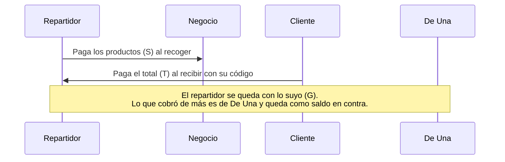
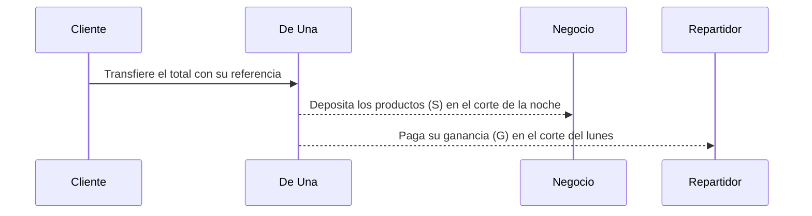

# 3. El dinero

De Una usa un **modelo mixto**:

- **Pago en efectivo:** el repartidor le paga al negocio en la tienda y le cobra todo al cliente. El negocio tiene su dinero al momento.
- **Pago por transferencia o tarjeta:** el dinero llega a De Una, que le deposita al negocio cada noche.

Todo queda en un **libro de movimientos**: nadie tiene que acordarse de cuánto le debe a quién.

## Las fórmulas

```
Total que paga el cliente (T) = Productos (S) + Envío (E) + Lluvia (L) + Pedido pequeño (PP)
                               + Servicio (V) + Propina (P)
                               − Descuentos de De Una (Dm) − Descuentos del negocio (Dn) − Saldo a favor (Dc)

Gana el repartidor (G)  = 85 % de E + L + PP + P + Bono
Gana el negocio         = S − Dn                   (con entrega propia: S + E + P − Dn)
Resultado de De Una     = V + 15 % de E − Dm − Bono
```

El saldo a favor (Dc) no es un costo nuevo: De Una ya lo había contado como costo cuando lo regaló (por un reclamo o un premio de vecino).

## Cómo se mueve el dinero en cada caso

### Efectivo, con repartidor de De Una



Ejemplo: Jorge compra $120 en Abarrotes Mary, con $25 de envío, $7 de servicio y $10 de propina. T = $162.

| Quién | Caja | Libro | Total |
|---|---|---|---|
| Pedro (repartidor) | −$120 a la tienda, +$162 del cliente = **+$42** | +$21.25 envío, +$10 propina, −$42 efectivo ajeno = **−$10.75** | **$31.25** (su ganancia) |
| Abarrotes Mary | +$120 | — | **$120** |
| De Una | — | Pedro le debe $10.75 | **$10.75** ($7 de servicio + $3.75 del envío) |

### Pago en línea (transferencia o tarjeta)



El repartidor no paga ni cobra nada. El pedido no le llega al negocio hasta que **el dinero esté en la cuenta**. No se aceptan capturas de pantalla, que son el fraude más común en México.

### Entrega propia (gas y agua)

La gasera o la purificadora cobra todo. Como el servicio de $7 es de De Una, queda en su libro y se descuenta en su siguiente depósito o con la mensualidad. Si el pago fue en línea, De Una le deposita productos + envío + propina.

### Mandado

1. El repartidor compra con su dinero (hasta $500) y sube la foto del ticket.
2. El cliente aprueba el monto antes de que salga.
3. Al entregar, el repartidor cobra el ticket más el mandado.
4. El libro le reconoce lo que adelantó, así que solo le queda en contra la parte de De Una.

## El libro de movimientos

Cada movimiento tiene cuenta, monto, concepto y número de pedido. El signo siempre se lee desde De Una:

| Cuenta | Positivo | Negativo |
|---|---|---|
| `repa:<id>` | De Una le debe al repartidor | El repartidor trae efectivo de De Una |
| `neg:<id>` | De Una le debe depositar al negocio | El negocio le debe (mensualidad, anuncios, cargos) |
| `cli:<id>` | Saldo a favor del cliente | Adeudo del cliente |
| `du:<línea>` | Ingreso de De Una | Costo de De Una |

Líneas de De Una: `servicio`, `envio`, `mensualidad`, `anuncios`, `plus`, `adeudos`, `promos`, `bonos`, `garantia`, `reembolsos`.

## La regla de oro: el dinero siempre cuadra

Por cada pedido, lo que entra a la caja de De Una menos lo que De Una le debe a cada quien es igual a su resultado. Además:

- El repartidor siempre termina con exactamente su ganancia.
- El negocio siempre termina con exactamente su venta.

Las pruebas lo revisan pedido por pedido en todos los casos: efectivo, transferencia, entrega propia, mandado, promos, saldo a favor, cancelaciones, cliente ausente y reclamos (`cuadra()` en [`pruebas/motor.test.js`](../pruebas/motor.test.js)).

## Cortes

| Corte | Cuándo | Qué pasa |
|---|---|---|
| Negocios | Cada noche | Se deposita lo pagado en línea menos mensualidad, anuncios y cargos. Si la mensualidad estaba pendiente y alcanza, se marca como pagada. Si el saldo queda negativo, el negocio lo paga por transferencia. |
| Repartidores | Cada lunes | Si trae efectivo de De Una, lo deposita (OXXO o transferencia con su referencia `R-NOMBRE`). Si De Una le debe, se le paga. |

## Límites de efectivo

| Regla | Monto | Para qué |
|---|---|---|
| Cliente nuevo (primeros 3 pedidos) | Compras de hasta $400 en efectivo | Que nadie pida $1,000 de comida falsa en su primera vez |
| Cualquier cliente | Compras de más de $800 se pagan por adelantado | Que el repartidor no adelante tanto dinero |
| Repartidor con más de $500 de De Una | Solo recibe pedidos pagados en línea | Que el efectivo no se acumule en la calle |
| Repartidor con más de $800 | Se suspende hasta que deposite | Que nadie desaparezca con el dinero |
| Adelanto en mandados | Hasta $500 | Lo mismo, para mandados |

## Promociones: quién las paga

| Promo | La paga | Cuándo se registra |
|---|---|---|
| Primer envío gratis | De Una | Al entregar. Si el pedido se cancela, la promo regresa. |
| Envío gratis de un negocio (por ejemplo, la pizzería) | El negocio | Al entregar, como cargo en su libro |
| Plus | De Una | Al entregar |
| Invita a un vecino | De Una ($30 + $30) | Cuando el invitado recibe su primer pedido |
| Saldo a favor por reclamo | A quien se le cargó el reclamo | Al resolverlo |

## Lo que todavía no hace el piloto

- **Pagos con tarjeta.** Están en el diseño (ver [arquitectura](08-arquitectura.md)), pero en el piloto se usan efectivo y transferencia.
- **Facturación (CFDI).**
- **Retenciones fiscales y alta en el IMSS de los repartidores.** Por ahora quedan fuera porque es un piloto; antes de crecer, hay que revisarlas con un contador (ver [reglas](09-reglas-y-cumplimiento.md)).
