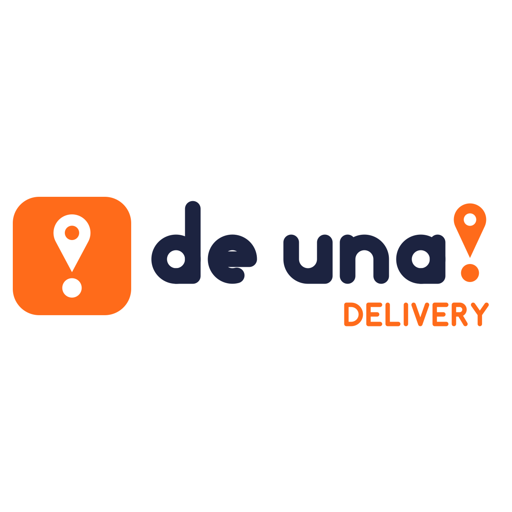

# 10. La marca

**De Una Delivery.** El nombre viene de “¡de una!”: rápido, sin rodeos y con buena actitud. Es lo que dices cuando se te antoja algo y lo quieres ya.

## La idea: el pin que es “!”

Un **pin de ubicación** y un **punto** debajo forman el signo de exclamación de “¡De una!”.

- **El pin** dice qué hacemos: llevarte el pedido a tu ubicación.
- **El signo** dice cómo: rápido, con energía, de una.
- **El punto** es tu casa, donde aterriza el pin.

Sigue las reglas de los mejores logos de delivery del benchmark (Swiggy, Just Eat, DoorDash, Deliveroo):

- un solo color plano;
- una sola forma blanca;
- una doble lectura (pin + “!”);
- se reconoce a 24 px;
- se puede dibujar de memoria.

Ninguna app de la zona usa un signo de exclamación.

## El logotipo

“de una!” está **dibujado a mano**: letras redondas de trazo grueso que no dependen de ninguna tipografía. Termina con el mismo pin del ícono. Abajo, **DELIVERY** en letras pequeñas.

| Versión | Archivo | Úsala en |
|---|---|---|
| Logo horizontal | `marca/logo.svg` / `.png` | Fondos claros: lonas, volantes, documentos |
| Logo sobre azul noche | `marca/logo-oscuro.svg` / `.png` | Fondos oscuros, redes sociales, playeras |
| Logo vertical | `marca/logo-vertical.svg` / `.png` | Espacios cuadrados, perfiles, stickers |
| Un solo color | `marca/logo-un-color.svg` / `.png` | Sellos, grabados, impresión a una tinta |
| Solo letras | `marca/logotipo.svg` | Cuando el ícono ya aparece cerca |
| Ícono | `marca/icono.svg` / `.png` | La app, foto de perfil |
| Ícono sobre noche | `marca/icono-noche.svg` / `.png` | Fondos naranjas o fotos con mucho color |
| Símbolo solo | `marca/simbolo.svg` | Bolsas, cajas, mochilas de reparto |

Todo sale de un solo script: si cambias algo en `marca/generar.js` y corres `node marca/generar.js`, se actualizan el ícono de la app, los logos y las piezas que usa la app.

**Reglas de uso:**
- Deja alrededor del logo un espacio libre del tamaño del punto del signo.
- Tamaño mínimo: el ícono a 24 px y el logo horizontal a 120 px de ancho.
- No lo estires, no lo rotes y no le pongas sombras ni degradados.
- No cambies sus colores ni pongas el pin naranja sobre fondo naranja (para eso está la versión blanca).

## Colores

| Nombre | Hex | Para qué |
|---|---|---|
| Mandarina | `#FF6B1A` | El color de la marca: ícono, botones, lo que se toca |
| Mandarina clara | `#FF9A4D` | El código de entrega y los acentos sobre azul |
| Miel | `#FFB547` | Promociones |
| Azul noche | `#1C2340` | Encabezados, fondos importantes, el logotipo |
| Tinta | `#141A2E` | Texto principal y texto sobre mandarina |
| Crema | `#FFF8F2` | Fondo de la app |
| Mandarina para texto | `#C2410C` | Texto naranja pequeño sobre blanco |

**Por qué mandarina con azul noche:** el naranja y el rojo están llenos (Rappi, DiDi Food, DoorDash, Just Eat, Swiggy). El azul noche es su complementario: hace que el naranja brille más, se ve premium y ninguna app de comida en México lo usa.

**Contraste:**
- Sobre mandarina, el texto va en **tinta** (6:1), no en blanco: se lee mejor y nos distingue.
- Sobre azul noche, el texto va en **crema**.

La app tiene **modo oscuro** con fondos azul noche y la misma mandarina.

## Tipografía

- **Títulos:** Bricolage Grotesque (700–800).
- **Texto:** Figtree (400–800).
- **Logotipo:** dibujado a mano, no usa tipografía.

## Ilustraciones e íconos

- **Ilustraciones:** todas son propias (comida, tiendita, farmacia, gas, garrafón, moto, regalos), en estilo plano y cálido, con un **borde blanco de estampa**. La bolsa de entrega lleva el símbolo de la marca. Viven en `ilustraciones.js`, y el borde lo pone el filtro `#sticker` de `index.html`.
- **Íconos de la interfaz:** de línea, con un relleno suave que se vuelve mandarina cuando están activos.

## Tono de voz

- Cercano y directo, como un vecino que te hace el paro: “¿Se te antojó? ¡De una!”.
- Claro con el dinero: todos los cargos a la vista, sin letras chiquitas.
- Nunca regañón: los límites se explican con el motivo.

## Pendiente antes de lanzar

- **Buscar y registrar la marca en el IMPI** antes de imprimir. Ojo: en Ecuador existe una app de pagos llamada *Deuna*.
- Registrar los usuarios en redes (por ejemplo, @deunadelivery) y el dominio.
