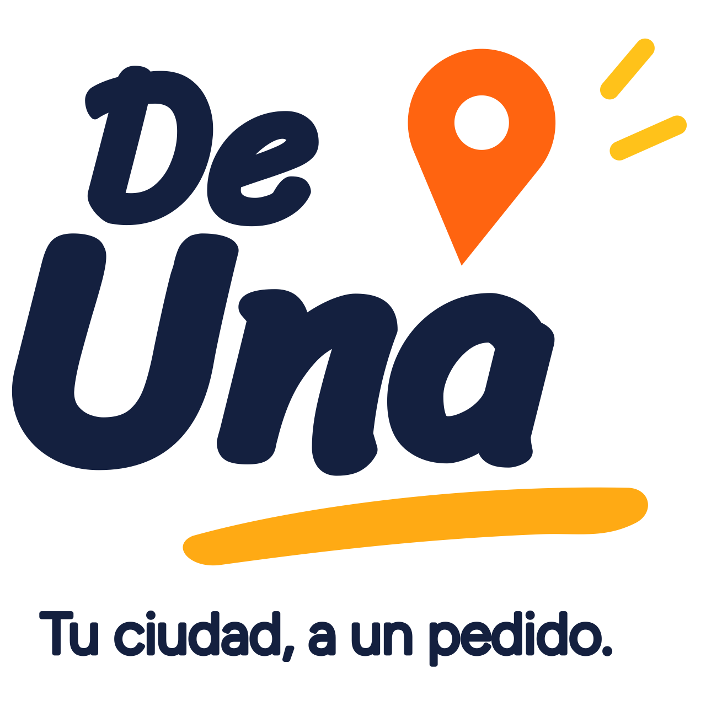

# 10. La marca

**De Una Delivery.** El nombre viene de “¡de una!”: rápido, sin rodeos y con buena actitud. El lema es **“Tu ciudad, a un pedido.”**

## El logo

“De Una” en letra script gruesa, en azul tinta, sobre dos renglones. A la derecha llega volando un **pin de ubicación** naranja (las dos chispas amarillas son el movimiento) y abajo un **subrayado ámbar** que dice “ya”.

- **El pin** dice qué hacemos: te lo llevamos a tu ubicación.
- **Las chispas y el subrayado** dicen cómo: rápido y con energía.
- **La letra script** se siente cercana, como un letrero pintado a mano de la colonia.

## El ícono de la app

El mismo logo sobre un **azulejo amarillo**, sin chispas, con el pin en **rojo** y el subrayado en azul tinta. El amarillo hace que el ícono se encuentre rápido en la pantalla del celular, donde casi todas las apps de comida son rojas o naranjas.

## Versiones

| Versión | Archivo | Úsala en |
|---|---|---|
| Logo | `marca/logo.svg` / `.png` | Fondos claros: lonas, volantes, documentos |
| Logo con lema | `marca/logo-lema.svg` / `.png` | Lonas, volantes y presentaciones |
| Logo sobre azul tinta | `marca/logo-oscuro.svg` / `.png` | Fondos oscuros, redes sociales, playeras |
| Un solo color | `marca/logo-un-color.svg` / `.png` | Sellos, grabados, impresión a una tinta |
| Ícono | `marca/icono.svg` / `.png` | La app y la foto de perfil |
| Ícono sobre azul tinta | `marca/icono-noche.svg` / `.png` | Fondos amarillos o fotos con mucho color |
| Pin solo | `marca/simbolo.svg` | Bolsas, cajas, mochilas y el mapa |

Todo sale de un solo script: si cambias algo en `marca/generar.js` y corres `node marca/generar.js`, se actualizan el ícono de la app, los logos y las piezas que usa la app.

Las letras vienen ya convertidas a trazos en `marca/trazos.json`, así que no hace falta instalar ninguna fuente. Salen de **Sriracha** (letras) y **Figtree** (lema), las dos con licencia SIL Open Font License, que permite usarlas en logos. A “De” se le engrosa el trazo 6 unidades y a “Una” 13, para que pesen como el dibujo original.

**Reglas de uso:**
- Deja alrededor del logo un espacio libre del alto de la “e”.
- Tamaño mínimo: el ícono a 32 px y el logo a 120 px de ancho. A menos de eso las letras se empastan; para favicon de 16 px usa el pin solo.
- No lo estires, no lo rotes y no le pongas sombras ni degradados.
- No cambies sus colores. Sobre amarillo, el pin va en rojo; sobre crema, en naranja.

## Colores

Sacados del logo original.

| Nombre | Hex | Para qué |
|---|---|---|
| Amarillo | `#FFC21A` | El ícono, la bienvenida, las promociones y las chispas |
| Naranja | `#FF6410` | El pin, los botones, lo que se toca |
| Rojo | `#FF3B16` | El pin sobre amarillo (solo en el ícono) |
| Ámbar | `#FFAA14` | El subrayado del logo y acentos sobre azul |
| Azul tinta | `#14203F` | Las letras del logo, el texto y los encabezados |
| Crema | `#FBF6F3` | El fondo de la app |
| Naranja para texto | `#C2410C` | Texto naranja pequeño sobre blanco |

**Contraste:**
- Sobre naranja y amarillo, el texto va en **azul tinta**, no en blanco: se lee mejor.
- Sobre azul tinta, el texto va en **crema**.

La app tiene **modo oscuro** con fondos azul tinta y el mismo naranja.

## Tipografía

- **Logo:** letras dibujadas (de Sriracha, engrosadas), ya en trazos.
- **Títulos:** Bricolage Grotesque (700–800).
- **Texto y lema:** Figtree (400–800).

## Ilustraciones e íconos

- **Ilustraciones:** todas son propias (comida, tiendita, farmacia, gas, garrafón, moto, regalos), en estilo plano y cálido, con un **borde blanco de estampa**. La bolsa de entrega lleva el pin amarillo. Viven en `ilustraciones.js`, y el borde lo pone el filtro `#sticker` de `index.html`.
- **Íconos de la interfaz:** de línea, con un relleno suave que se vuelve naranja cuando están activos.

## Tono de voz

- Cercano y directo, como un vecino que te hace el paro: “¿Se te antojó? ¡De una!”.
- Claro con el dinero: todos los cargos a la vista, sin letras chiquitas.
- Nunca regañón: los límites se explican con el motivo.

## Pendiente antes de lanzar

- **Buscar y registrar la marca en el IMPI** antes de imprimir. Ojo: en Ecuador existe una app de pagos llamada *Deuna*.
- Registrar los usuarios en redes (por ejemplo, @deunadelivery) y el dominio.
